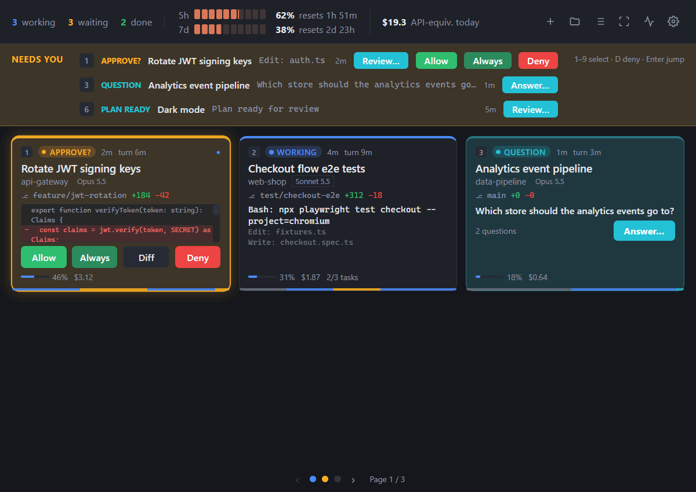
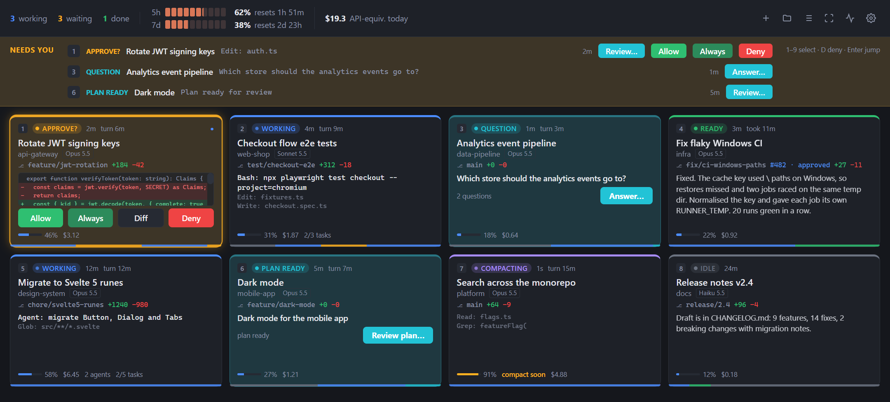
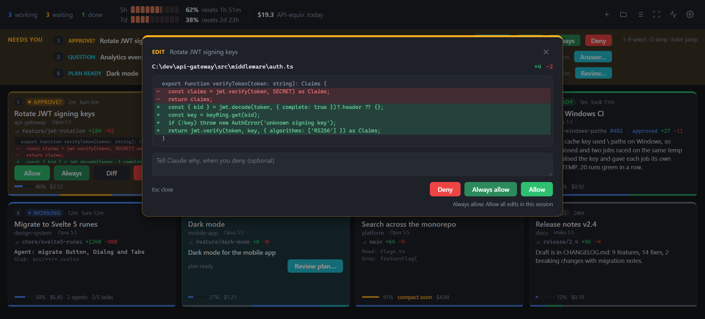
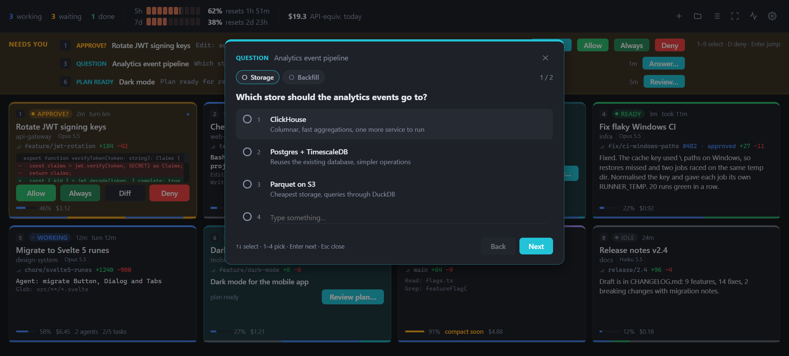
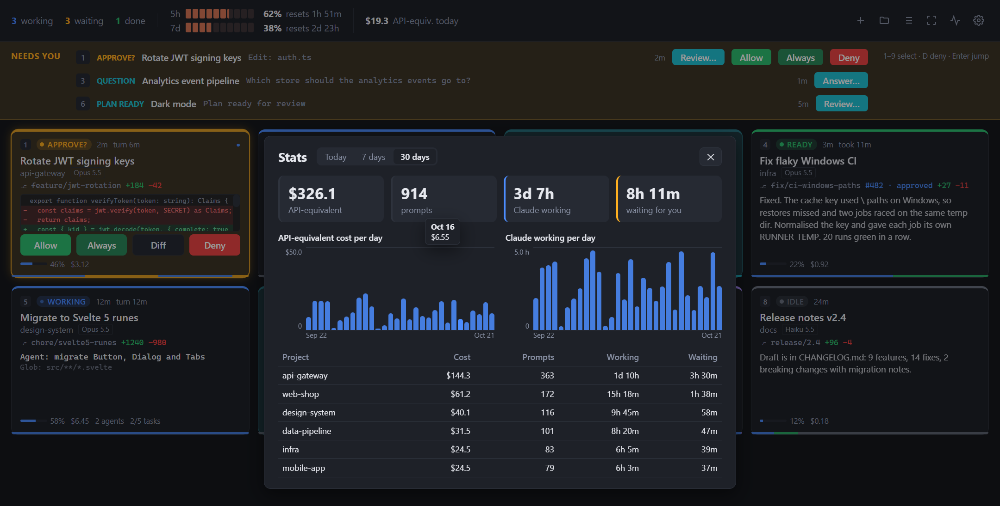
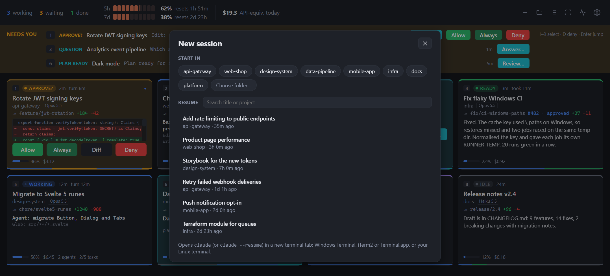
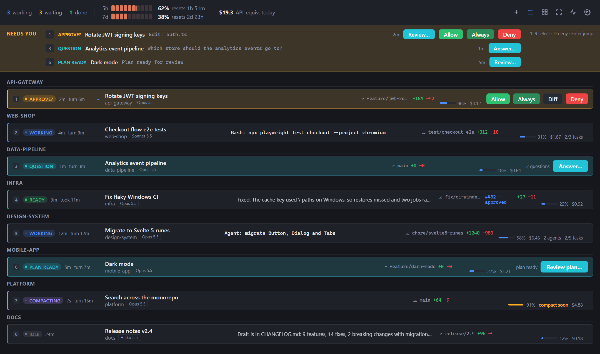
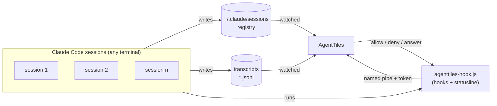

<div align="center">


# AgentTiles

**Mission control for Claude Code.** Every running session on one screen: who is working, who needs you, and what
they want. Approve, answer and jump straight to the right terminal.

[](https://github.com/workedbeforepush/agenttiles/actions/workflows/ci.yml)
[](LICENSE)




</div>

---

## Why

You start one Claude Code session. Then a second one for the tests, a third for the refactor, one more in the other
repo. Ten minutes later one of them has been waiting for your approval the whole time, hidden in a terminal tab
you are not looking at.

AgentTiles puts all of them on one screen, made for a second monitor. It finds sessions that are **already running**,
in any terminal or IDE. You don't have to start them in a special way.

## Features



**See everything at a glance**
- One live tile per session: state (working, approve?, question, plan ready, ready, compacting, limit hit, error),
  current tool call, the last few steps, branch, lines changed, model, context use and cost.
- A **"Needs you" banner** lists every session that waits for you, oldest first.
- A 30-minute history strip per tile shows how each session spent its time.
- Hover a tile for the last prompt and Claude's last reply, rendered as Markdown.

**Act without switching windows**
- **Allow, Always allow or Deny** a tool call right on the tile. Claude Code's own dialog stays open in parallel,
  and the first answer wins.
- **See the diff before you allow.** Edit, MultiEdit and Write requests show the change, with an optional reason
  that Claude receives when you deny.
- **Answer questions** (AskUserQuestion) in a dialog modelled on the terminal's, with tabs, options, free text and
  the same keys.
- **Read plans** rendered as Markdown before you decide in the terminal.
- **Jump to the terminal**: a click focuses the session's terminal: the exact tab in Windows Terminal (even across
  windows), Terminal.app or iTerm2, or the terminal window on Linux.

| Review a change | Answer a question |
|---|---|
|  |  |

**Never miss a moment**
- Distinct sound cues per state, adjustable volume, and system notifications.
- A repeated reminder while a session keeps waiting.
- A warning before the context window fills up.
- The tray icon and taskbar button show how many sessions wait for you.

**Know your budget**
- **5-hour and 7-day plan limits** in the header, with reset times and a forecast of when you will hit the limit at
  your current pace.
- Cost today and **stats over 7 or 30 days**, per day and per project.

| Stats | Start or resume a session |
|---|---|
|  |  |

**Made for many sessions**
- Filter by state with a click on the header counters, group tiles by project, or switch to a compact list.
- Fixed tile sizes with paging, full screen and keyboard control (all shortcuts configurable).
- Start a new session in any recent project, or **resume** an ended one, in a new terminal tab.
- Pin, rename, reorder by drag and drop, hide sessions or whole projects.



## Quick start

> Installers are not published yet. Until then, run AgentTiles from source. It takes about a minute.

Requirements: [Node.js](https://nodejs.org) 22 or later, and Claude Code.

```sh
git clone https://github.com/workedbeforepush/agenttiles.git
cd agenttiles
npm install
npm start
```

On first start, AgentTiles asks whether to install its **hooks** and the **statusline wrapper** in
`~/.claude/settings.json`:

- **Without them**, AgentTiles still shows every session and its state, from Claude Code's session registry and
  transcripts.
- **Hooks** add live tool activity, Allow / Deny / answer from AgentTiles, subagents and tasks.
- The **statusline wrapper** adds cost, context use and plan limits. A statusline you already have keeps working;
  AgentTiles runs it and passes its output through.

Both can be switched off again in Settings, and AgentTiles then removes exactly what it added.

## How it works



- **Discovery:** Claude Code keeps a small registry file per running session. AgentTiles watches that folder, so it
  finds every interactive session immediately, including ones that were running before AgentTiles started.
- **Details:** it tails each session's transcript for the title, last prompt, reply and tool calls.
- **Live events and decisions:** optional command hooks forward events over a local named pipe, protected by a
  random token. For permission requests the hook waits for your decision in AgentTiles; Claude Code's own dialog
  stays usable in parallel.
- **Limits:** the statusline wrapper reports cost, context and rate limits. Every 10 minutes AgentTiles also runs one
  tiny `claude -p` request (about 600 tokens) to read the current 5h and 7d limits. Click the limits in the header
  to refresh them on demand.

## Privacy and safety

- **Everything stays on your machine.** AgentTiles has no server, no telemetry and no account. The only network
  traffic is the limit check above, which is a normal Claude Code request.
- **It never reads your credentials.** Claude Code's `.key` files next to the session registry are left alone.
- **It fails open.** If AgentTiles is not running or does not answer, the hook steps aside, and Claude Code asks in the
  terminal as usual. Hidden sessions and print-mode runs are never held.
- **Allow is click-only.** No keyboard shortcut can approve a request, so approving is always deliberate.
- **Reversible.** Turning hooks or the statusline off in Settings restores `~/.claude/settings.json`.

## Platform support

| | Windows 10/11 | macOS 🧪 | Linux 🧪 |
|---|---|---|---|
| Live tiles, approvals, questions, limits, stats | ✅ | ✅ | ✅ |
| Jump to the session's terminal | ✅ exact Windows Terminal tab, any window; click again to minimize | ✅ exact tab in Terminal.app and iTerm2; other apps (VS Code, JetBrains, Ghostty, …) come to the front | ✅ the terminal window, on X11 with `xdotool` (Wayland does not allow it) |
| Start / resume sessions | ✅ Windows Terminal | ✅ iTerm2, else Terminal.app | ✅ first installed of gnome-terminal, konsole, kitty, wezterm, alacritty, ghostty, xfce4-terminal, tilix, foot, xterm |
| Waiting count outside the window | ✅ tray + taskbar badge | ✅ menu bar + Dock badge | ✅ tray + launcher count (where the desktop supports it) |
| Start with system login | ✅ | ✅ | ✅ XDG autostart |

🧪 **macOS and Linux are new and experimental.** Their logic is unit-tested and CI runs the UI on both, but the
terminal integration has not been tried on real machines yet. Feedback in the
[issues](https://github.com/workedbeforepush/agenttiles/issues) is very welcome.

Notes:
- **macOS:** the first jump to a Terminal.app or iTerm2 tab asks whether AgentTiles may control that app (System
  Settings → Privacy & Security → Automation). AgentTiles takes the `PATH` from your login shell, so `node` and
  `claude` from Homebrew, nvm or Claude's installer are found even when AgentTiles starts from the Dock.
- **Linux:** install `xdotool` for the terminal jump (`sudo apt install xdotool` or your distribution's package).

## Keyboard

Every shortcut can be changed or switched off in Settings → Keyboard.

| Key | Action |
|---|---|
| `1`–`9` | select tile |
| `Enter` | jump to the selected session's terminal, or open its question / review |
| `D` | deny the selected or longest-waiting request |
| `PgUp` / `PgDn` | previous / next page |
| `Esc` | close dialog, clear selection, leave full screen |
| `F11` | full screen |

## FAQ

**Does AgentTiles slow Claude Code down?**
No. Hooks are tiny Node scripts that send one message and exit. They are asynchronous except for permission
requests, which wait only while AgentTiles shows the request.

**Can I approve plans from AgentTiles?**
Not yet. AgentTiles shows the plan, but Claude Code takes the plan decision only in its own dialog, so "Decide in
terminal" jumps there.

**How is this different from Claude Code's own agent view or the desktop app?**
Agent view (`claude agents`) lives in a terminal and lists background sessions. The desktop app manages the
sessions it started itself. AgentTiles watches *every* interactive session on the machine, wherever it runs, on a
separate screen, and lets you act on them from there.

**What does the "API-equivalent" cost mean?**
It is what the session would cost at API prices, as reported by Claude Code. On a subscription plan you don't pay
this amount; the plan limits in the header are what matters there.

**How do I remove everything?**
Turn off hooks and the statusline in Settings, quit AgentTiles and delete the folder. Its own data lives in
`%APPDATA%\agenttiles` (Windows) or the platform's equivalent.

## Development

```sh
npm run dev           # development with hot reload
npm run typecheck     # TypeScript 7 for main and renderer, svelte-check for .svelte files
npm test              # vitest
npm run screenshots   # regenerate the images in docs/images from demo data
```

If `npm install` did not download the Electron binary (`node_modules/electron/dist` is empty), run
`node node_modules/electron/install.js`.

Stack: Electron, TypeScript, Svelte 5, Vite. The pure state logic lives in `src/core` and is the best place to
start reading; see [CONTRIBUTING.md](CONTRIBUTING.md) for the project layout.

## Roadmap

- Installers (MSIX for Windows, with the native taskbar badge; DMG; AppImage)
- Confirm macOS and Linux on real machines and drop the "experimental" label
- Exact tab selection in more terminals (WezTerm, kitty, tmux) and IDE terminals

Ideas and votes are welcome in [Discussions](https://github.com/workedbeforepush/agenttiles/discussions) and
[Issues](https://github.com/workedbeforepush/agenttiles/issues).

## Contributing

Bug reports, ideas and pull requests are welcome. Please read [CONTRIBUTING.md](CONTRIBUTING.md) first. Security
issues go through [SECURITY.md](SECURITY.md), not public issues.

If AgentTiles saves you some tab-hunting, a ⭐ helps others find it.

## License

[MIT](LICENSE) © workedbeforepush

AgentTiles is an independent project and is not affiliated with, endorsed or sponsored by Anthropic. Claude and Claude
Code are trademarks of Anthropic, PBC.
